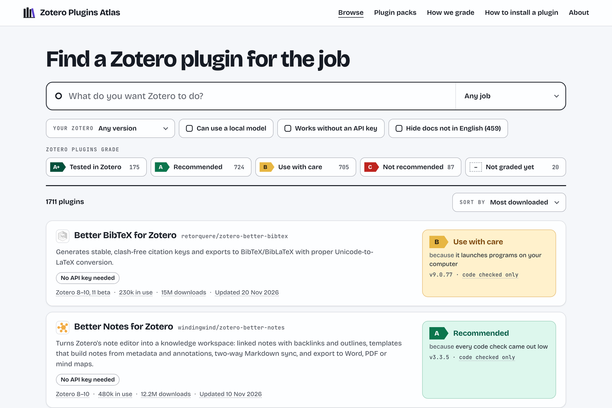

<p align="center"></p>

<h1 align="center">Zotero Plugins Atlas</h1>

<p align="center"><strong>Every Zotero plugin, checked before you install.</strong><br>
zoteroplugins.org reads the code of each plugin's release file and tells you what it does, what it
needs from you and where it sends your data, with the evidence one click away.</p>

<p align="center">
  <a href="https://zoteroplugins.org/browse"><strong>Browse the catalogue</strong></a> ·
  <a href="https://zoteroplugins.org/how-we-grade">How we grade</a> ·
  <a href="https://zoteroatlas.com">Zotero Atlas</a>, the catalogue inside Zotero
</p>

<p align="center">
  <a href="https://zoteroplugins.org/browse"></a>
  <a href="LICENSE"></a>
  <a href="data/LICENSE"></a>
</p>

<p align="center"></p>

## What it checks

The catalogue tracks more than 2,000 Zotero plugins on GitHub. For every listed one it downloads
the release file you would install, reads all of its code without running it, and writes a card:

- **Where your data goes.** Every destination in the plugin's own code and who runs it: the
  developer, a known service, or a server we couldn't identify. Text or keys sent over plain
  `http://` are flagged.
- **What it can do on your computer.** Launching programs, downloading and running code, installing
  other add-ons, turning off security settings, writing to Zotero's database directly.
- **Whether the code can be read.** Obfuscated or encrypted code, hidden characters, and who
  uploaded the release file.
- **What it needs from you.** A key or sign-in of your own, a local model, or nothing.
- **Whether it works with your Zotero.** Compatibility with each Zotero version, and for some
  plugins a live test in a throwaway Zotero.

The worst finding sets the grade: **A+** (recommended, and behaved as its card says in a live
Zotero), **A** (recommended: every code check came out low), **B** (use with care: read why
first) or **C** (not recommended). The rules, finding by finding:
[docs/methodology.md](docs/methodology.md).

## For plugin developers

- [For developers](https://zoteroplugins.org/developers): how to see what holds your plugin's
  grade back.
- Think a finding is wrong? [Respond to your card](https://github.com/iliasbeshimov/zoteroplugins.org/issues/new?template=card-response.yml).
  Your response is published on the card, and a fix to a check goes into the scanner for every plugin.
- Graded A or B? Your card has a badge for your README.

## Open data

Everything on the site is built from this repository. The data is CC BY 4.0: hand-checked listings
in `data/plugins/`, every analysis in `data/generated/`, and the catalogue as JSON at
[zoteroplugins.org/api/plugins.json](https://zoteroplugins.org/api/plugins.json).

If the catalogue saved you time, a star helps other people find it.

## Layout

```
schema/     zod schemas + generated JSON Schema (schema/json/) shared by pipeline and site
pipeline/   the `atlas` CLI: ingest → fetch → analyze → provenance → enrich → score → build-data
site/       Astro + Tailwind static site
data/
  plugins/     <slug>.yaml: curated, human-edited listing and review data
  generated/   <slug>/plugin.json and <slug>/<version>.json: machine output, committed for audit
docs/       methodology: how plugins are checked and graded
zotero-atlas/        the Zotero Atlas plugin: finds and installs plugins from the directory inside Zotero (site/ is zoteroatlas.com)
install-link-blocker/ the Install Link Blocker plugin
```

`.cache/` (git-ignored) holds downloaded `.xpi` files, API responses and READMEs, content-addressed
by SHA-256.

## Development

Requires Node ≥ 22.12 (CI uses 24) and pnpm 10.

```sh
pnpm install
cp .env.example .env        # add GITHUB_TOKEN (read-only); ANTHROPIC_API_KEY only for enrichment

pnpm atlas --help           # pipeline CLI
pnpm atlas census           # find every Zotero plugin on GitHub (no LLM)
pnpm atlas profile          # profile + scorecard for every listed plugin (no LLM)
pnpm atlas profile -p zotero-pdf-translate   # one plugin
pnpm atlas regress          # before changing the analyzer or rules: every label change, offline
pnpm atlas catalog          # data/generated/catalog.json, what the Zotero Atlas plugin reads
pnpm site:dev               # local site
pnpm verify                 # lint, type check, tests, schema check, site build (same as CI)
pnpm schema:generate        # after editing schema/src/*
```

## Docs

- [docs/methodology.md](docs/methodology.md): what each check looks at and how the grade is set
- [pipeline/src/profile/score.ts](pipeline/src/profile/score.ts): the rule table, in code
- [sandbox/README.md](sandbox/README.md): the live test in a throwaway Zotero

## License

Code: [MIT](LICENSE). Data in `data/`: [CC BY 4.0](data/LICENSE).
