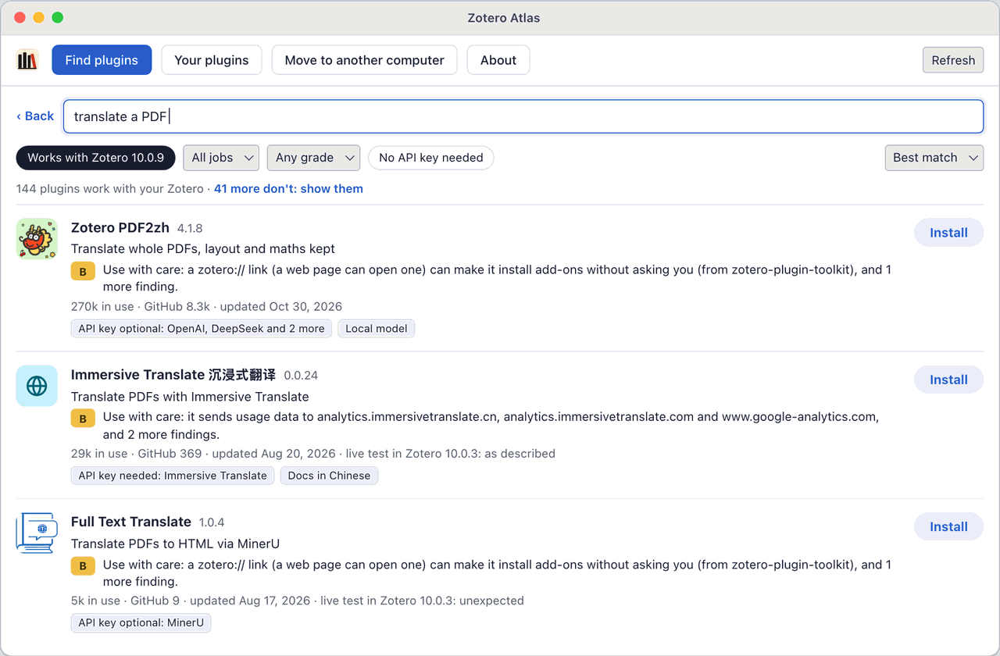
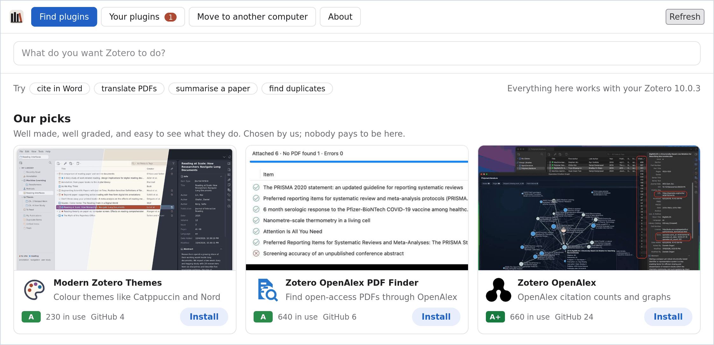
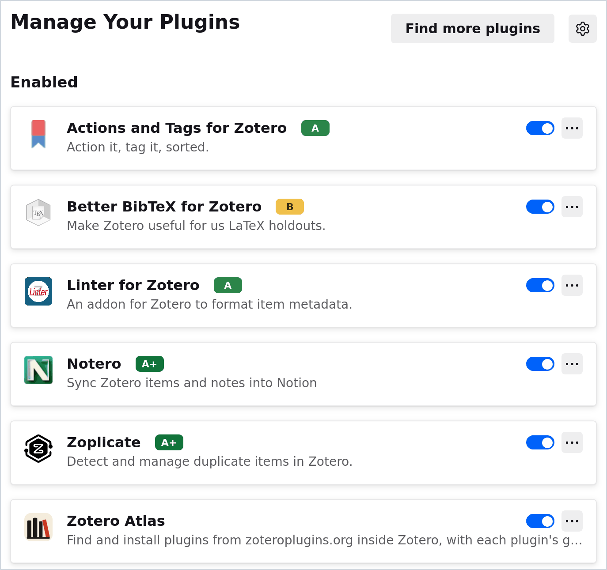
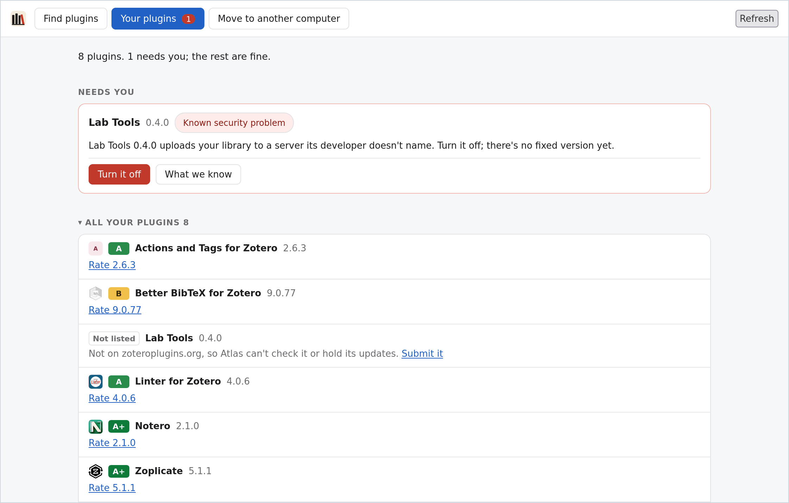
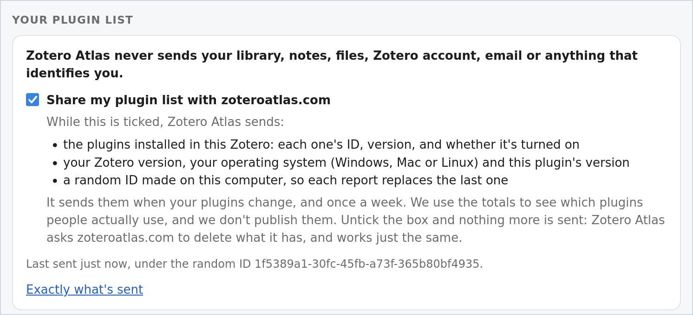

<p align="center"></p>

<h1 align="center">Zotero Atlas</h1>

<p align="center"><strong>Every Zotero plugin, one click away. Each one checked first.</strong><br>
The <a href="https://zoteroplugins.org">zoteroplugins.org</a> catalogue inside Zotero: search 1,500+
plugins, see what each one's code does, and install in one click.</p>

<p align="center">
  <a href="https://zoteroatlas.com/install?start"><strong>Download Zotero Atlas</strong></a> ·
  <a href="https://zoteroatlas.com/install">How to install</a> ·
  <a href="https://zoteroatlas.com">zoteroatlas.com</a>
</p>

<p align="center">
  <a href="https://zoteroplugins.org/p/zotero-atlas"></a>
  <a href="https://github.com/iliasbeshimov/zotero-atlas/releases/latest"></a>
  <a href="https://zoteroplugins.org/p/zotero-atlas"></a>
  <a href="https://www.zotero.org/download/"></a>
  <a href="#check-what-you-install"></a>
  <a href="LICENSE"></a>
</p>

<p align="center"></p>
<p align="center"><sub>The search example from zoteroatlas.com, with real catalogue entries. The screenshots below are Zotero Atlas 1.3 in Zotero 10.</sub></p>

## What it does

### Find, and install the file that was checked

<p align="center"></p>

- **Find.** Tools → Zotero Atlas opens on the same shelves as zoteroplugins.org: our picks, the
  most used plugins, plugin packs for students and researchers, Rising, New and catching on, and
  the eight jobs (reading, citing, AI, translation, organising, metadata, interface, files), all
  filtered to the plugins that work with your Zotero. Search for what you want Zotero to do: each
  result shows its grade and the reason for it, what it needs from you (an API key, a local
  model) and about how many people use it. A plugin's page in Atlas has the rest: what we found,
  ratings, and the versions we checked. Nobody pays to be on a shelf.
- **Install the file we checked.** Every install, a whole pack included, goes through one sheet
  that shows the grade and its reason first, then what the plugin needs, then the file. Install
  hands that release file to Zotero's own installer with the SHA-256 of the file we analysed.
  Zotero refuses the file if it doesn't match, so what you get is exactly what the card
  describes. A file we haven't analysed can't be installed from here.

### Grades in Tools → Plugins

<p align="center"></p>

- **Grades in Tools → Plugins.** Each plugin gets its grade by its name, "Not listed" when the
  catalogue doesn't list it (so Atlas can't check it), and one line only when there's something
  to know. "Find more plugins" opens Atlas.

### Hold updates, go back, and hear only what matters

<p align="center"></p>
<p align="center"><sub>Example: Lab Tools is a made-up plugin with a made-up advisory, from the project's test setup.</sub></p>

- **Hold updates until they're checked** (the one question when you install it, recommended; a
  setting afterwards, in About and Zotero's settings). Zotero installs plugin updates by itself without looking at what changed. With
  this on, an update whose file the catalogue has analysed, and whose grade isn't lower than the
  version you have, installs as usual, usually within a day. Anything else waits in "Your
  plugins" for you to update anyway or keep your version. Plugins the catalogue doesn't list are
  never held: we can't check them. Holding uses Zotero's own install listeners and changes no
  Zotero setting, so removing the plugin gives Zotero back its own updates.
- **Turn plugins off and on, or remove them.** Each plugin in "All your plugins" has Turn off
  (or Turn on) and Remove…. Remove asks first, and offers to turn it off instead: some plugins
  delete their settings as soon as they're removed, and Undo doesn't bring those back. Then
  Zotero stops the plugin at once and deletes it when you close the Atlas window, with Undo
  until then, the way Zotero's own Plugins window does. It also asks, if you'd like, how the
  plugin was: the people who remove a plugin are the ones other Zotero users most need to hear
  from. Nothing is sent unless you post a rating.
- **Go back after an update.** "Your plugins" lists the month's updates, and for each one whose
  earlier version we analysed, offers to go back to it: the file we checked, after which its
  updates wait until you choose.
- **Say what matters, and only that.** A blocked plugin, or one on the catalogue's list of known
  security problems ([data/advisories.json](https://github.com/iliasbeshimov/zoteroplugins.org/blob/main/data/advisories.json)),
  gets a bar above your library until you turn it off or close the bar. A held update, a grade
  drop, a plugin Zotero turned off when a version that works is listed, or a newer version Zotero
  hasn't installed in three days gets one notice and a red dot on the Zotero Atlas button by the
  sync button, until you look. A plugin you've turned off gets neither: what's known about it
  waits in "Your plugins" until you turn it back on. Everything else waits quietly there too.

### Rate what you use

- **Rate what you use.** Stars, and a review if you want to write one, for any plugin you have or
  removed in the last 30 days. No account. Ratings show next to each plugin's grade, but never
  change it: the grade is what the code does, the rating is what people who use it say.
- **Asked once, after two weeks.** When a plugin has been turned on for two weeks, a blue dot on
  the Zotero Atlas button asks how it's working (the red dot stays for things that need you). At
  most three plugins at a time, at most once a month, and each plugin only once. No notices, and
  nothing is sent unless you click Post.

### Move to another computer

- **Take your plugins with you.** Save a list of the plugins in this Zotero, with their settings
  if you want them (API keys and passwords go in only when you tick that), then open the list in
  Zotero Atlas on the other computer. It shows what it would install, then installs only files
  the catalogue checked, the same way Install does. The file stays where you save it: Atlas sends
  nothing about it anywhere.

Every grade comes from the catalogue's published checks: see
[how plugins are graded](https://zoteroplugins.org/how-we-grade). The plugin itself is listed and
graded there like any other.

## What it sends, and what it never sends

**It never sends your library, notes, files, Zotero account, email or anything that identifies
you.**

<p align="center"></p>

Sharing isn't asked when you install it: **Share my plugin list** starts ticked. The box is at the
bottom of **About** in the Zotero Atlas window, and in Zotero's settings under Zotero Atlas. While
it's ticked, the plugin sends one thing: the list of plugins installed in this Zotero, with their
versions and whether each is turned on, under a random ID created on this computer, together with
your Zotero version, operating system and this plugin's version. That goes to zoteroatlas.com
shortly after you install it, when the list changes, and once a week. We use the totals to see
which plugins people actually use, and we don't publish them. Untick the box and nothing more is
sent: the plugin asks the server to delete the record, and works just the same. If you chose
**Don't send** in an earlier version, that choice stays. "Exactly what's sent", under the box,
shows the exact message. The server's code is in [server/](server/); it stores nothing from the
request but those fields, no IP address.

**When you post a rating**, and only then, it sends to zoteroatlas.com: the plugin and version you
rate, your stars and review, your Zotero version and operating system, this plugin's version, and
a scrambled ID for this Zotero, so rating again replaces your rating. The ID is a slow hash of a
random key Zotero makes for its database; the key itself is never sent, and nothing is stored on
your computer for it. While **Share my plugin list** is ticked, the rating also carries that list's
random ID, so the rating can say how long you had the plugin. Reviews are public, shown as
"Zotero Atlas user" with your Zotero version; links are removed. We never store your IP address:
for ratings, the server keeps a scrambled code made from it for 30 days to catch fake reviews,
after which even we can't match it to anything. Every rating is checked before it's published, and
how fake ones are spotted isn't published, so it can't be gamed.

Whatever you choose, the plugin fetches the catalogue once a day and its list of
known security problems every 6 hours, both from GitHub (raw.githubusercontent.com, the
catalogue's public repository). Find plugins shows plugin icons and screenshots from the same
repository; pictures from anywhere else, a README's own host for example, are never loaded. When
you click Install or go back to an earlier version,
Zotero downloads the plugin file from GitHub. Nothing else is contacted, except zoteroatlas.com
when you post a rating. Links to zoteroplugins.org open in your browser with `?ref=atlas` added,
which only tells the site not to show its note about Atlas; the site takes it out of the address
before its analytics load.

It stores four settings (`extensions.zotero-atlas.usage`, `.updates`, `.id`, `.state`) and the
catalogue and the advisories in `zotero-atlas/` in your Zotero data directory. Uninstalling
removes all of it.

## Its own grade

On zoteroplugins.org this plugin is graded **B**, because sending usage data to a developer's
server rates "medium" under the catalogue's rules, whether or not it's opt-in, because it
installs other add-ons, and because it changes other plugins (it holds their updates and turns
one off when you click "Turn it off"). Those are the same rules every plugin gets. The grade is set by the same
pipeline as every other plugin's and nothing on its card is edited by hand.

## Check what you install

All the plugin's code is in [src/](src/): `bootstrap.js` (what it does), `content/` (the window),
`settings.xhtml` and `settings.js` (the settings pane), `prefs.js` (the defaults), `manifest.json`
and `icon.svg`. `content/` holds the Atlas window (About included), the first-run screen, the styles it adds to
Zotero's main window and to Tools → Plugins, and the two icons. The plugin file is those files zipped as they are, with nothing compiled or bundled:

- **Unzip it and compare** (rename the `.xpi` to `.zip` if your computer won't open it): the files
  are exactly the ones in `src/` at that release's tag.
- **Rebuild it:** `python3 build.py` on the tagged commit makes a byte-identical file on any
  system. Compare its SHA-256 with the downloaded file's (`shasum -a 256 <file>` on a Mac or
  Linux, `Get-FileHash <file>` in Windows PowerShell).
- **Check where it was built:** each release's files are built by [the release
  workflow](.github/workflows/release.yml) from the tagged commit and come with GitHub's build
  attestation: `gh attestation verify <file> --repo iliasbeshimov/zotero-atlas`.

## Updates

Zotero checks this project's releases for updates, as it does for other plugins, and installs an
update only if it matches the SHA-256 in that release's `updates.json`. Atlas never holds its own
updates. Turn automatic updates off for this plugin in Tools → Plugins if you'd rather update by
hand.

## Development

```sh
node test.cjs          # offline checks of the plugin's behaviour, with Zotero mocked
python3 build.py       # dist/zotero-atlas-<version>.xpi and dist/updates.json
```

Before a release it's also walked through in real Zotero 7, 8, 9 and 10 by the catalogue's
sandbox (`sandbox/run.sh atlas` in the catalogue's repository): first run, a real update held,
the button and the bar, Tools → Plugins and the Atlas window, About and its box last, with
pictures of each.

Needs Zotero 7.0 or later. The catalogue it reads is written by the catalogue's pipeline
(`atlas catalog`); its shape is published as `catalog.schema.json` in the catalogue's repository.

Zotero Atlas is developed together with the catalogue it reads, in
[iliasbeshimov/zoteroplugins.org](https://github.com/iliasbeshimov/zoteroplugins.org) (`zotero-atlas/`); this
repository publishes its releases. If it's useful to you, a star there helps other people find both.
